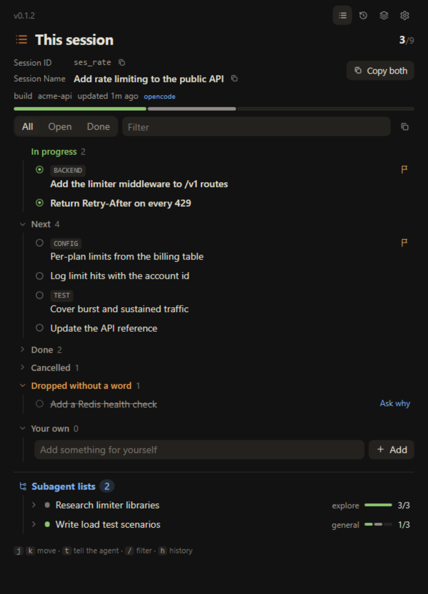
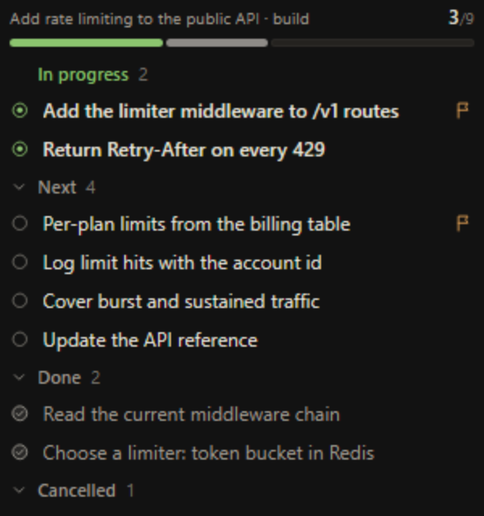
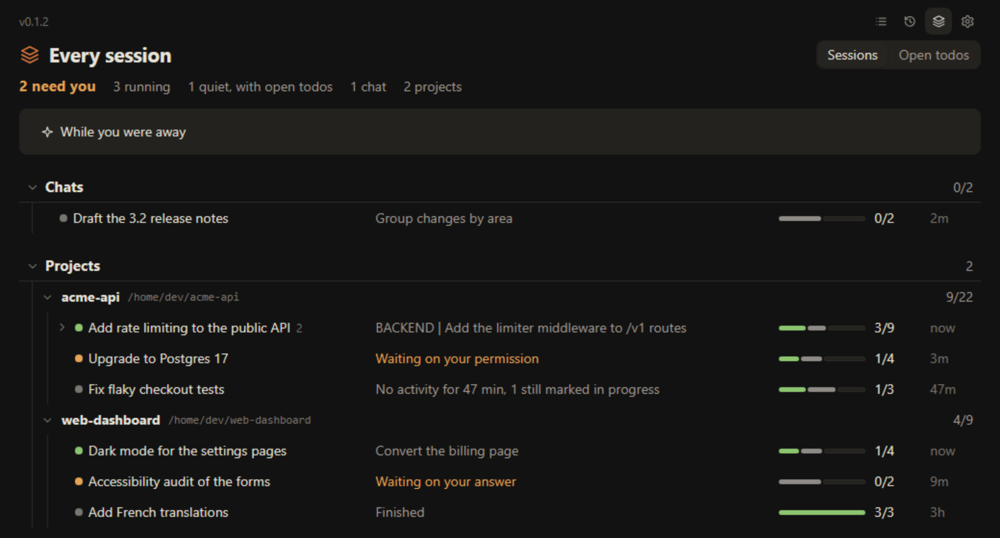
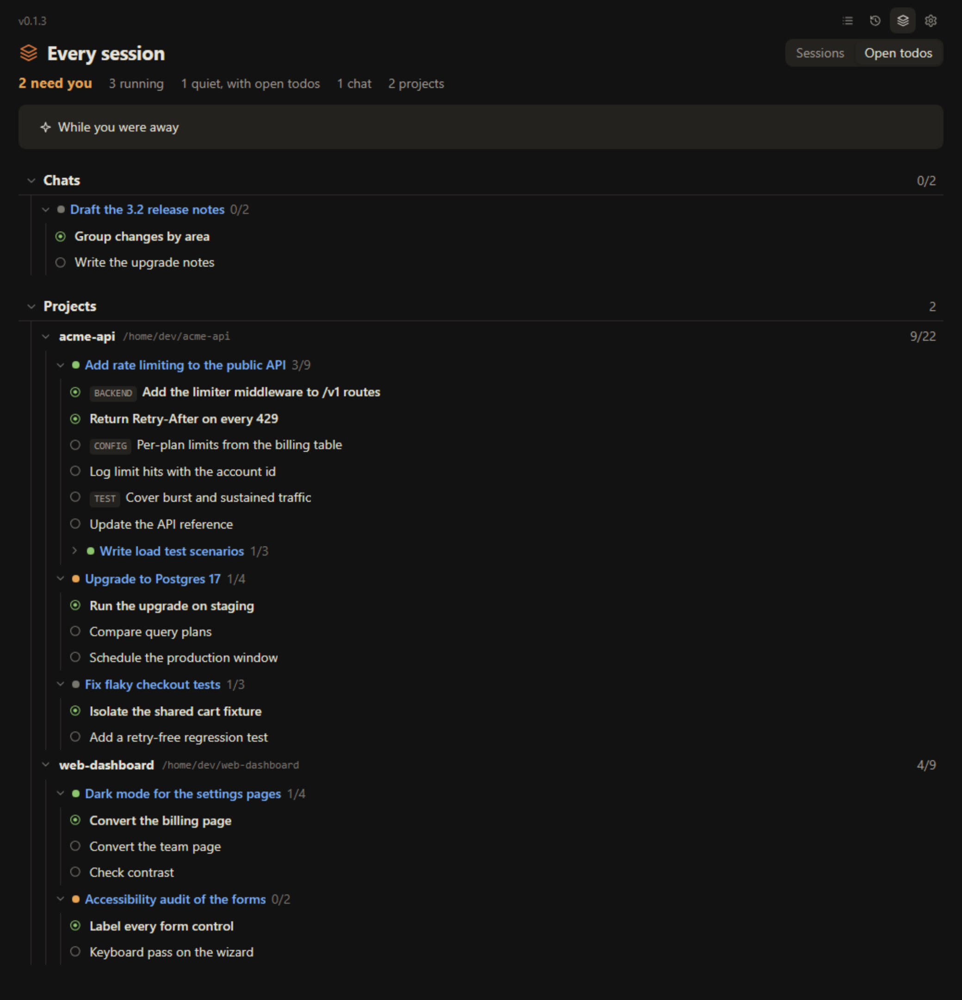
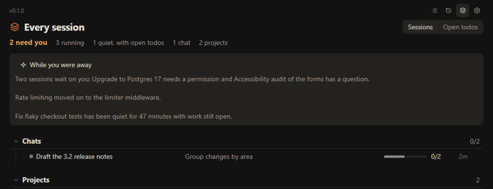
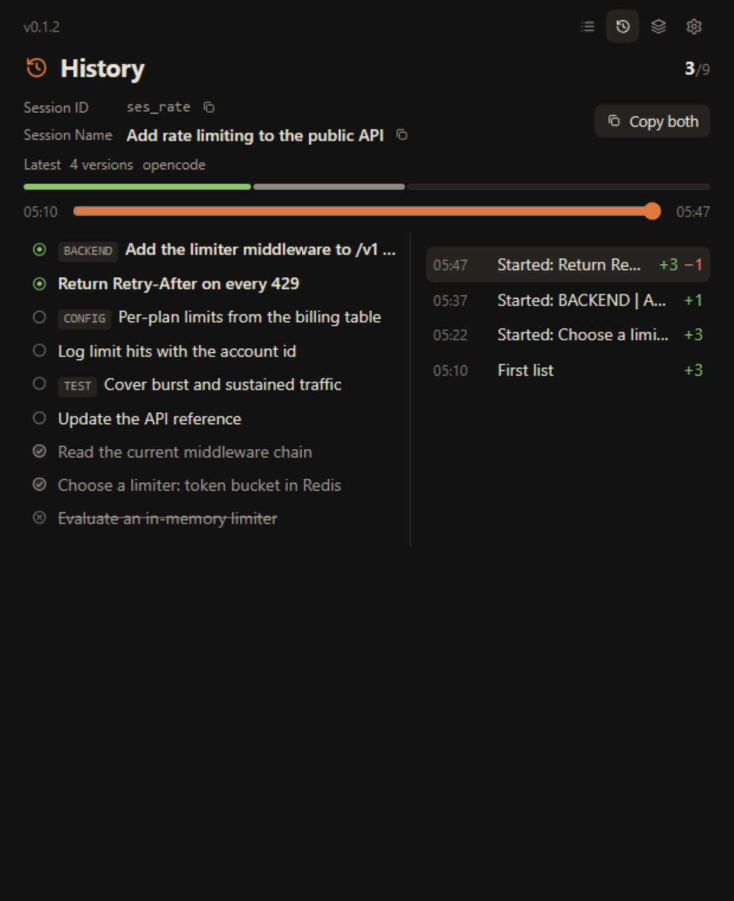
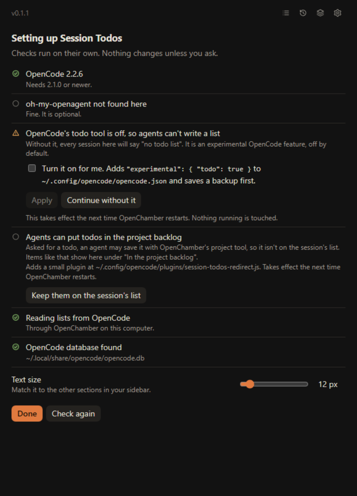
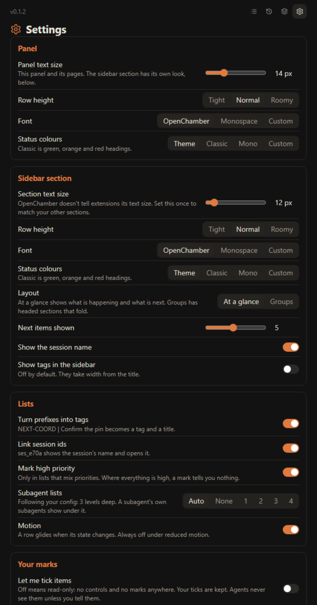

# Session Todos

An [OpenChamber](https://openchamber.dev) extension that shows what your agents planned, what they are doing now, and what they need from you, across every session and project.

It reads the todo lists agents already write. It adds what those lists lack: an honest status, your own ticks and notes, subagent lists under their parent, a history of every change, and one overview of all your sessions.



> The screenshots use the real extension with invented sample data.

## Contents

- [What you get](#what-you-get)
- [Before you install](#before-you-install)
- [Install](#install)
- [Set up your todo source](#set-up-your-todo-source)
- [Updating](#updating)
- [Using it](#using-it)
- [Settings](#settings)
- [Where lists come from](#where-lists-come-from)
- [Permissions and privacy](#permissions-and-privacy)
- [Troubleshooting](#troubleshooting)
- [Remove it](#remove-it)
- [Development](#development)
- [License](#license)

## What you get

| Surface | What it shows |
|---|---|
| **Work Status section** | The open session's list at a glance, in the sidebar beside the chat. |
| **Rail panel** | The full list for one session, with subagents, filters, details, your marks and history. |
| **Every session** | All your sessions and projects, grouped by what needs you, plus a cross-session list of open todos. |

The list follows the session you have open, and each session keeps its own list. Subagent lists sit under their parent.

### Work Status section



What is happening and what comes next, in one look, grouped under headings that fold. For a shorter view with no headings, choose **At a glance** in Settings. Hide, show or move the section from Work Status > Choose sections.

### Every session



Open it from the layers icon at the top of the panel. Sessions are grouped by project and by what they need: waiting on you first, then active ones. A subagent is listed only if it has a todo list or is waiting on you. The view covers sessions active in the last 7 days, and you can change that from 1 to 90.



**Open todos** flattens every session's unfinished items into one list.



**While you were away** writes a short digest using the Small Model you set in OpenChamber. It runs only when you ask, and you can turn the offer off in Settings.

### History



Each version of a list is kept on your computer. Replay how a plan changed, and see **items dropped without a word**: things an agent removed from its list without finishing or cancelling them. Under the **Open** filter they fold to one line with a count. Click a long item in a version to read all of it; click it again, or another item, to close it. **Play** steps through the versions one a second and shows the date and time of each. Below, every subagent down to your depth setting has a timeline of its own, folded until you click it.

### Your own marks

Turn on **Let me tick items** in Settings to tick items and add notes. Agents never see these unless you choose to tell them about an item. Your marks stay separate from the agent's list, so a tick is never mistaken for the agent's own progress.

### Small things that help

- **Honest states.** A session waiting on your permission or answer says so, and a session that has gone quiet with work still open says "no activity" (after 10 minutes by default).
- **Tags from prefixes.** `BACKEND | Add the limiter` becomes a `BACKEND` tag and a shorter title. Turning tags off hides the prefix; panel and sidebar have independent toggles.
- **Session links.** A session id in a todo shows that session's name and opens it.
- **Your own todos.** Type `/todo` in a chat, or use **Add to my todos** on a message.
- **Copy as Markdown** and **Export** (list, history, ticks and notes, as JSON).
- **Toasts and a badge.** One toast when a session starts waiting on you, and an open-item count on the rail icon. Both can be turned off.
- **Keyboard.** In the list: `j` / `k` move, `x` ticks, `t` tells the agent about the item, `/` filters.

## Before you install

- **OpenChamber 2.5.0 or newer**, on web or desktop. OpenChamber does not load extensions on mobile or in VS Code.
- **A todo source.** Agents need something that writes a list. Use either one:
  - [oh-my-openagent](https://github.com/code-yeongyu/oh-my-openagent) (OMO), or
  - **OpenCode 2.1.0 or newer** with its experimental todo tool turned on.

OpenCode 2.x turned its todo tool off by default and OpenChamber removed its per-session todo panel, so without one of these sources every session says "no todo list". [Set up your todo source](#set-up-your-todo-source) covers both.

## Install

1. Open OpenChamber > **Settings > Extensions**.
2. Add this Git address:

   ```
   https://github.com/mradwankhalil/openchamber-session-todos
   ```

3. Review the permissions it asks for and approve them. [Permissions and privacy](#permissions-and-privacy) explains each one.
4. Reload the UI if the panel does not appear (command palette: **Reload UI**).
5. Open **Session Todos** from the right rail. A setup check runs the first time.

There is nothing to build. The built files are part of the repository.

> Install from the Git address. OpenChamber only offers updates for Git installs, not for folder or ZIP installs.

## Set up your todo source

The first time you open the panel, it checks your setup and tells you what it found. It changes nothing unless you ask.



You can run it again any time from Settings > **Where lists come from** > **Run the setup check**.

### Option A: with oh-my-openagent

If you run [oh-my-openagent](https://github.com/code-yeongyu/oh-my-openagent), there is nothing more to do. It gives agents `todowrite` and keeps each session's list in `.omo/v2-state/todos.json` inside the session's folder. Session Todos finds and reads that file, and the setup check shows **oh-my-openagent found**.

If you want to try OpenCode's own todo tool in one folder, the setup check offers **Use OpenCode's todo tool in this folder**. Sessions that are already there keep their oh-my-openagent lists.

### Option B: with OpenCode v2 only

OpenCode's todo tool is an experimental feature and is off by default. Turn it on one of two ways.

**From the setup check (easiest).** Tick **Turn it on for me** and choose **Apply**. It adds the setting to your OpenCode config and saves a backup first.

**By hand.** Add this to your OpenCode config, usually `~/.config/opencode/opencode.json`:

```json
{
  "experimental": { "todo": true }
}
```

Either way, the change takes effect the next time OpenChamber restarts. Nothing already running is touched. New sessions then have `todowrite`, and their lists show up on their own.

A managed or organisation-wide config can force the setting off. The setup check tells you if that is what is happening, because a change in your own config would not take effect.

### Optional: keep agents' todos on the session's list

The page has three boxes, each folding from its title: **This session** (its name and ID, each with a copy button, then its todo groups and your own items), **Subagents**, and **Plans**. If the session works on a plan from Project knowledge, the Plans box shows its title, how many steps are done, and its phases and steps; phases with work left start unfolded and finished ones folded. Click the title to open Project knowledge. It is the plan OpenChamber sent to this session or, when none was sent, the plan file this session was the last top-level session to edit.

Asked to track something, an agent may save it to OpenChamber's project backlog instead of the session's list. Those items appear under **Project Todos Backlog**, one line each: click one to read all of it, or the arrow to open Project knowledge. To keep them on the session's list instead, choose **Keep them on the session's list** in the setup check. That adds one small OpenCode plugin file, which you can remove with **Stop doing this**. It only blocks new backlog todos created by agents. Notes, plans and the Project panel are untouched.

## Updating

OpenChamber checks a Git install's repository for a newer `version` in `package.json`, at most once an hour, and offers the update in Settings > Extensions. Your settings, ticks and notes are kept across an update.

Coming from a folder install? OpenChamber can't offer updates for it. Remove it and add the Git address instead. Removing an extension clears its saved settings, ticks and notes, so use **Export** first if you want a copy.

The version you are running is shown at the top left of the panel.

## Using it

- **Open a session.** The panel and the sidebar section follow it.
- **Click a row** to see its full text and details.
- **Filter** with All, Open or Done, or type in the filter box. Subagents follow the filter: Open lists those with work left and shows only that work, with cancelled items folded; Done lists those with finished items and shows only those. Each filter splits them into **Active subagents** (working, or waiting on you) and **Idle subagents**, with the most recent first. A subagent stays under the one that started it.
- **Fold** subagents and groups. Top-level sessions start open and sub-sessions start folded. In Every session, Chats and other projects start folded and the project you are in starts unfolded all the way; folds there start over each time the panel opens.
- **Use the icons at the top of the panel:** This session, History, Every session and Settings.

## Settings



Changes apply at once, in every frame.

| Group | What you can change |
|---|---|
| **Panel** | Text size, row height, font and status colours for the panel and its pages. |
| **Sidebar section** | The same appearance options on their own (custom status colours are one set, shared with the panel), plus layout, how many next items show, the session name, tags and hover. |
| **Lists** | Tags from prefixes, session links, high-priority marks, how deep subagent lists go, motion. |
| **Your marks** | Turn ticking on or off, and clear this session's ticks and notes. |
| **Attention** | When to say "no activity", toasts, and the rail badge. |
| **Every session** | How many days of sessions to show, and whether to offer a digest. |
| **Where lists come from** | Turn each source on or off, and set its path if yours is unusual. |
| **History and data** | Keep history or not, its folder, export, and reset. |

OpenChamber doesn't tell extensions its text size, so set **Section text size** once to match your other sections. Text size defaults to 15 px in the panel and 13.75 px in the sidebar section. Saved text sizes are kept.

## Where lists come from

Sources are found automatically and tried in this order. A list on screen is never blanked by a failed read: a bad read keeps what is already there.

1. **The oh-my-openagent store:** `.omo/v2-state/todos.json` in the session's folder.
2. **The OpenCode session:** the newest todo list in the session's messages, read through OpenChamber. This needs `experimental.todo`.
3. **The OpenCode database:** read-only. It is used when OpenChamber has a password set, and for older lists.

If you set a password on OpenChamber, the extension can't use OpenChamber's own API and reads OpenCode's database directly instead. It never asks for or stores your password. If the database isn't found, set its path in Settings.

## Permissions and privacy

| It asks for | Why |
|---|---|
| **Files** | To read the oh-my-openagent list in the open project. |
| **Sessions** | To follow the open session, and to list sessions and projects for the overview. |
| **Model** | To write the digest, only when you ask for one. |
| **A local service** | A small background process on your computer that reads OpenCode's lists and config, keeps history, and listens only on the loopback address. |

Everything stays on your computer. The extension has no telemetry and sends nothing anywhere itself. The one thing that leaves is the digest: when you ask for one, your session titles and lists go to the Small Model you chose in OpenChamber.

It only writes to these places, and the first two only when you ask:

- your OpenCode config, with a backup first, if you choose **Turn it on for me**
- `.opencode/opencode.json` in a folder, if you choose to use OpenCode's todo tool there
- the optional plugin file in your OpenCode plugins folder, if you turn it on
- `~/.local/share/openchamber-session-todos`, for history (the folder can be changed, and history can be turned off)

## Troubleshooting

| You see | Do this |
|---|---|
| **No todo list** in every session | Your agents have no todo tool. Run the setup check and follow [Set up your todo source](#set-up-your-todo-source). |
| The setting is on, but nothing changed | `experimental.todo` takes effect when OpenChamber restarts. Sessions started before that don't have the tool. |
| **OpenCode is too old** | Upgrade OpenCode to 2.1.0 or newer. |
| **The local service did not answer** | Approve Session Todos in Settings > Extensions. Lists from oh-my-openagent still work without it. |
| **Can't reach OpenCode's lists** | OpenChamber has a password set and no database was found. Set the database path in Settings. |
| The list looks stale | The list is what the agent last wrote. Look for "no activity" and check the session itself. |
| No **Update** is offered | Only Git installs get updates. See [Updating](#updating). The check runs at most once an hour. |

## Remove it

Settings > Extensions > Session Todos > Remove. This clears its saved settings, ticks and notes. It doesn't remove these, so delete them yourself if you no longer want them:

- `~/.local/share/openchamber-session-todos`, or the folder you chose for history
- the `experimental.todo` setting in your OpenCode config
- `session-todos-redirect.js` in your OpenCode plugins folder, if you turned it on (or choose **Stop doing this** first)

## Development

You need [Bun](https://bun.sh).

```sh
bun install
bun run build       # writes panel/main.js, status/main.js, service/main.js and the CSS copies
bun test
bun run typecheck
```

OpenChamber loads the built files, so they are committed. Rebuild before you commit a change.

| Path | What it is |
|---|---|
| `package.json` | The extension manifest (`openchamber.contributes`) |
| `panel/` | The rail panel and the full-screen page |
| `status/` | The Work Status section |
| `service/` | The local service: lists, config, history and the setup check |
| `shared/` | Reading lists, settings, and styles used by both frames |
| `tests/` | `bun test` |

To release a new version, raise `version` in `package.json`, rebuild, and push to `main`. Installed copies then offer the update. The panel takes its version number from `package.json`.

To try a local copy, add this folder in Settings > Extensions. Folder installs get no update offers.

## License

[MIT](LICENSE)
